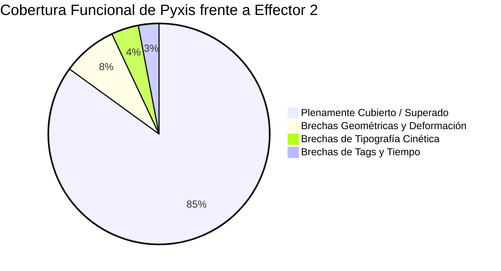
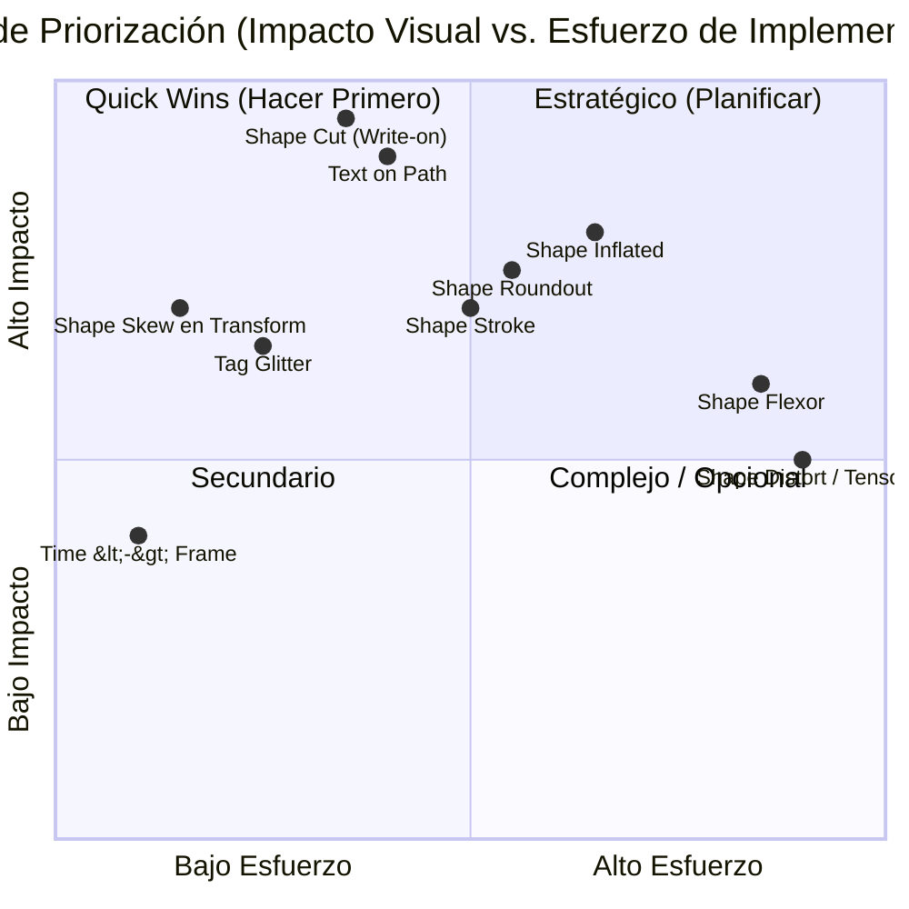

# Reporte Técnico de Brechas: Effector 2 vs. Pyxis Nodes Engine

Este documento presenta una auditoría técnica comparativa entre la librería de referencia **Effector 2** ([`newkara_library.lua`](file:///f:/Kara%20Effector/Node/Antigravity-PyxisNode/C%C3%B3digo%20de%20referencia%20(no%20se%20modifica)/Effector%202/kelibs/newkara_library.lua), versión actualizada al 18 de agosto de 2026, 8.543 líneas) y el sistema visual **Pyxis Nodes Engine** ([`node_engine.py`](file:///f:/Kara%20Effector/Node/Antigravity-PyxisNode/Versi%C3%B3n%20en%20desarrollo/PyxisNodes/node_engine.py), [`nodes_library.py`](file:///f:/Kara%20Effector/Node/Antigravity-PyxisNode/Versi%C3%B3n%20en%20desarrollo/PyxisNodes/nodes_library.py) y el catálogo de 59 nodos registrados).

El objetivo es servir como base de decisión para priorizar qué capacidades deben ser desarrolladas primero y qué arquitectura técnica requiere cada una.

---

## 1. Resumen Ejecutivo y Diagnóstico Global

- **Cobertura actual estimada**: **85%**.
- **Ventajas estructurales de Pyxis**: Supera a Effector 2 en arquitectura de usuario (grafo visual en lugar de scripts de texto o GUI estática), motor de audio-reactividad nativa (FFmpeg/FFT/RMS), streaming de previsualización MPV de baja latencia con HTTP 206, y curvas Bézier equidistantes por longitud de arco.
- **Áreas donde Effector 2 conserva ventajas**: Algoritmos puros de manipulación y deformación vectorial de polígonos ASSdraw (`cut`, `roundout`, `oblique`, `inflated`, `flexor`), tipografía sobre trayectorias (`text.bezier`) y generadores estocásticos de tags (`glitter`).

---

## 2. Matriz Comparativa Detallada por Módulos

| Módulo / Capacidad | Effector 2 (`ke`) | Pyxis Nodes (Estado Actual) | Cobertura | Diagnóstico |
| :--- | :--- | :--- | :---: | :--- |
| **Bucles y Control** | `setcswl`, `maxloop` en código Lua | `Main Loop`, `MaxLoop` (Normal/FBF), `Module` | 🟢 100% | Plenamente equivalente y más flexible visualmente. |
| **Persistencia / Memoria** | `ke.recall.remember`, `memory` | Nodos `Memory`, `Get Var`, `Define Vars`, `Sys Var` | 🟢 100% | Cubierto en su totalidad. |
| **Interpolación & Morphing** | `ke.shape.ipol`, `ke.color.ipol` | `Functions/Interpolator` ($t^{\text{accel}}$, alpha, color, morphing) | 🟢 100% | Morphing continuo vectorial con remuestreo de Clipper integrado. |
| **Curvas y Splines** | Fórmulas polinomiales directas | `Bezier Curve` con reparametrización por arco (`Subdivs`) | ⭐ Superado | Pyxis resolvió la velocidad no uniforme de Effector 2. |
| **Audio-reactividad** | `ke.shape.bars` (barras estáticas) | `Audio Modulator` (RMS, Peak, Bandas, FFT), `Audio Waveform` | ⭐ Superado | Decodificación WAV nativa de audio del proyecto. |
| **Oscilador de Tags** | `ke.tag.oscill` | `Tag Oscillator` (onda, duty cycle, dilatación, ritmos) | ⭐ Superado | Mayor parametrización que la función original de Effector. |
| **Librería de Formas** | 13 formas básicas | `Shapes Library` (43 formas vectoriales) | ⭐ Superado | Catálogo significativamente más amplio. |
| **Transliteración Kana** | `romaji`, `hiragana`, `katakana` | Modo Kana integrado en nodo `Text` | 🟢 100% | Soporta 5 modos bidireccionales con sokuon. |
| **Vectorización Raster** | `ILL/IMG.moon` (LodePNG, Potrace) | `IMG to Shape` (Potrace + pyclipper), `IMG to pixels` | 🟢 100% | Totalmente integrado al backend de Python. |
| **Transformación Básica** | `size`, `ratio`, `rotate`, `displace` | `Shape Transform` (Scale X/Y, Angle, Offsets, Anchor) | 🟢 100% | Cubre escala, rotación, traslación y borde offset. |
| **Deformación Morfológica** | `inflated`, `distort`, `flexor`, `tensor` | `Shape Transform` (Inflate, Distort, Flexor, Tensor) | 🟢 100% | **Brecha 1**: Hinchado radial, curvado de arco y deformación de malla. |
| **Corte Paramétrico (Trazo)**| `ke.shape.cut(t)` | `Shape Walker` (Modos Global y Por Contorno, Tip, Angle) | 🟢 100% | **Brecha 2**: Efecto write-on / trazado progresivo $t \in [0, 1]$. |
| **Redondeo de Esquinas** | `ke.shape.roundout(radius, mode)` | `Shape Transform` (Round Corners: Bezier / Bisel) | 🟢 100% | **Brecha 3**: Fillet y chamfer en vértices poligonales con $t$. |
| **Cizallamiento / Skew** | `ke.shape.oblique(px, t)` | `Shape Transform` (Modo Skew con Angle X/Y, $t$ y Anclajes) | 🟢 100% | **Brecha 4**: Inclinación 2D y perspectiva planar paramétrica. |
| **Grosor de Línea (Stroke)** | `ke.shape.line(bord)` | `Shape Stroke` (Round, Square, Butt, Miter, Bevel) | 🟢 100% | **Brecha 5**: Conversión de spline/línea a polígono cinta con PyClipper. |
| **Texto en Trayectoria** | `ke.text.bezier(shp, mode, offset)` | `Text on Path` (Center, Left, Right, Justified, Anim) | 🟢 100% | **Brecha 6**: Tipografía métrica con rotación tangencial `\frz` y normal. |
| **Efecto Glitter / Chispas** | `ke.tag.glitter(dur, tag1, tag2)` | Emulado manualmente con `MultiRandom` | 🟡 40% | **Brecha 7**: Falta generador algorítmico de ráfagas. |
| **Conversión Tiempo-Frame** | `time_to_frame`, `frame_to_ms` | Expresiones matemáticas manuales | 🟡 40% | **Brecha 8**: Faltan nodos de conversión usando FPS del video. |

---

## 3. Catálogo Técnico de Brechas Faltantes

### Brecha 1: Deformaciones Morfológicas (`inflated`, `distort`, `flexor`)
- **Ubicación de referencia**: [`newkara_library.lua:4906-4970`](file:///f:/Kara%20Effector/Node/Antigravity-PyxisNode/C%C3%B3digo%20de%20referencia%20(no%20se%20modifica)/Effector%202/kelibs/newkara_library.lua#L4906-L4970)
- **Concepto matemático**:
  - `inflated(t)`: A diferencia de `offset` (que hace desplazamiento normal uniforme $\pm D$), `inflated` calcula el centroide $(c_x, c_y)$ y desplaza cada vértice radialmente hacia la circunferencia/elipse circunscrita teórica:
    $$d_{\text{nueva}} = d_{\text{actual}} \cdot (1 - t) + R(\theta) \cdot t$$
    Produce el efecto de "hinchazón esférica" o abombamiento tipo globo.
  - `flexor(curve, t)`: Curva los puntos de una forma rectangular o texto a lo largo de una spline directriz, recalculando $(x, y)$ respecto a la normal y longitud de arco de la curva.
- **Complejidad estimada**: **Media-Alta**.
- **Propuesta Pyxis**: Crear un nodo dedicado `Shape/Shape Deform` o sub-modos dentro de `Shape Transform`.

### Brecha 2: Corte Paramétrico por Longitud de Arco (`cut` / Write-on)
- **Ubicación de referencia**: [`newkara_library.lua:4647-4675`](file:///f:/Kara%20Effector/Node/Antigravity-PyxisNode/C%C3%B3digo%20de%20referencia%20(no%20se%20modifica)/Effector%202/kelibs/newkara_library.lua#L4647-L4675)
- **Concepto matemático**:
  Dado un trazado vectorial ASS (contorno de letra o dibujo) de longitud total $L$:
  1. Para un progreso $t \in [0.0, 1.0]$, calcula la distancia meta $d = t \cdot L$.
  2. Mantiene todos los segmentos completos que quedan antes de $d$.
  3. Corta el segmento que contiene a $d$ (usando la fórmula de subdivisión de de Casteljau para curvas Bézier o interpolación lineal para rectas).
  4. Descarta el resto.
- **Impacto visual**: Permite animaciones de escritura caligráfica, trazo progresivo de bordes y revelado de siluetas. Actualmente Pyxis solo corta en trozos con `Shape Slicer`.
- **Complejidad estimada**: **Media** (Pyxis ya cuenta con `_sample_polyline_arc_length` en [`node_engine.py`](file:///f:/Kara%20Effector/Node/Antigravity-PyxisNode/Versi%C3%B3n%20en%20desarrollo/PyxisNodes/node_engine.py#L1712)).
- **Propuesta Pyxis**: Crear el nodo `Shape/Shape Cut` con entradas `[Shape, Progress (0-1), Invert]`.

### Brecha 3: Redondeo y Achaflanado de Esquinas (`roundout`)
- **Ubicación de referencia**: [`newkara_library.lua:4202-4250`](file:///f:/Kara%20Effector/Node/Antigravity-PyxisNode/C%C3%B3digo%20de%20referencia%20(no%20se%20modifica)/Effector%202/kelibs/newkara_library.lua#L4202-L4250)
- **Concepto matemático**:
  Inspecciona los vértices consecutivos $(P_{i-1}, P_i, P_{i+1})$. Si el ángulo interior es pronunciado, reemplaza el vértice puntual $P_i$ por:
  - En modo **Round**: un arco de curva Bézier tangente a ambas aristas con radio $r$.
  - En modo **Bevel**: una recta achaflanada entre los dos puntos de corte a distancia $r$.
- **Complejidad estimada**: **Media**.
- **Propuesta Pyxis**: Propiedad o nodo `Shape/Round Corners` (`[Shape, Radius, Mode: Round/Bevel]`).

### Brecha 4: Cizallamiento e Inclinación Perspectiva (`oblique` / Skew)
- **Ubicación de referencia**: [`newkara_library.lua:4178-4200`](file:///f:/Kara%20Effector/Node/Antigravity-PyxisNode/C%C3%B3digo%20de%20referencia%20(no%20se%20modifica)/Effector%202/kelibs/newkara_library.lua#L4178-L4200)
- **Concepto matemático**:
  Transformación afín 2D de deformación angular:
  $$x' = x + y \cdot \tan(\theta_x)$$
  $$y' = y + x \cdot \tan(\theta_y)$$
  Permite dar cursiva a cualquier forma vectorial o crear efectos de falso 3D / proyección en suelo sin distorsionar la orientación general.
- **Complejidad estimada**: **Baja**.
- **Propuesta Pyxis**: Agregar las propiedades `Skew X` y `Skew Y` directamente en el nodo [`Shape Transform`](file:///f:/Kara%20Effector/Node/Antigravity-PyxisNode/Versi%C3%B3n%20en%20desarrollo/PyxisNodes/nodes/shape_nodes.py#L380).

### Brecha 5: Conversión de Trazado Abierto a Trazo con Grosor (`line` / Stroke)
- **Ubicación de referencia**: [`newkara_library.lua:4730-4765`](file:///f:/Kara%20Effector/Node/Antigravity-PyxisNode/C%C3%B3digo%20de%20referencia%20(no%20se%20modifica)/Effector%202/kelibs/newkara_library.lua#L4730-L4765)
- **Concepto matemático**:
  Toma un trazado que no es cerrado (por ejemplo, una línea generada por `Bezier Curve` o una espiral) y genera un polígono cerrado de dos caras paralelas desplazadas a $\pm \frac{\text{width}}{2}$ a lo largo de los vectores normales, cerrando los extremos en redondo (*round cap*) o cuadrado (*butt cap*).
- **Complejidad estimada**: **Media** (apoyado en `pyclipper.OffsetPolygons` o cálculo normal analítico).
- **Propuesta Pyxis**: Nodo `Shape/Stroke Path` o propiedad dentro de generadores de curvas.

### Brecha 6: Texto Cinético sobre Trayectoria (`Text on Path`) - 🟢 Implementado al 100%
- **Ubicación de referencia**: [`newkara_library.lua:5632-5651`](file:///f:/Kara%20Effector/Node/Antigravity-PyxisNode/C%C3%B3digo%20de%20referencia%20(no%20se%20modifica)/Effector%202/kelibs/newkara_library.lua#L5632-L5651)
- **Concepto matemático**:
  Recibe una curva guía (ASSdraw o parámetros de Bézier) y la línea/palabra activa:
  1. Mide el ancho de cada carácter o sílaba.
  2. Distribuye los centros sobre la longitud de arco acumulada (modos: centrado, izquierda, derecha, justificado $0 \to 1$).
  3. Emite automáticamente el tag `\pos(x, y)` y la orientación angular de la tangente `\frz(\theta)` para cada letra.
- **Implementación Pyxis**: Nodo [`Functions/Text on Path`](file:///f:/Kara%20Effector/Node/Antigravity-PyxisNode/Versi%C3%B3n%20en%20desarrollo/PyxisNodes/nodes/text_nodes.py) con badge de modo interactivo en cabecera y 6 slots de salida (`Tag Out`, `\pos Tag`, `Angle (\frz)`, `X`, `Y`, `Length`).

### Brecha 7: Generador de Ráfagas de Destellos (`Tag Glitter`)
- **Ubicación de referencia**: [`newkara_library.lua:6661-6685`](file:///f:/Kara%20Effector/Node/Antigravity-PyxisNode/C%C3%B3digo%20de%20referencia%20(no%20se%20modifica)/Effector%202/kelibs/newkara_library.lua#L6661-L6685)
- **Concepto matemático**:
  Genera bloques sucesivos de `\t(t1, t2, \fscxS1\fscyS1)\t(t3, t4, \fscxS2\fscyS2)` con tiempos y tamaños pseudoaleatorios desfasados entre sí, creando el efecto visual de "titileo de estrellas" o "brillos intermitentes".
- **Complejidad estimada**: **Baja**.
- **Propuesta Pyxis**: Agregar el nodo `Functions/Tag Glitter` o un modo `Glitter` en el `Tag Oscillator`.

### Brecha 8: Utilidades de Tiempo por Cuadro de Video (`Frame <-> Time`)
- **Ubicación de referencia**: [`newkara_library.lua:7010-7050`](file:///f:/Kara%20Effector/Node/Antigravity-PyxisNode/C%C3%B3digo%20de%20referencia%20(no%20se%20modifica)/Effector%202/kelibs/newkara_library.lua#L7010-L7050)
- **Concepto**: Nodos utilitarios `Time/Time to Frame` y `Time/Frame to Time` que resuelvan la conversión exacta según los FPS del video actual (23.976, 24, 25, 29.97, 60).
- **Complejidad estimada**: **Muy Baja**.

---

## 4. Clasificación por Complejidad y Dependencias

---

## 5. Propuesta de Fases de Implementación Sugerida

### Fase 1: *Quick Wins* y Alto Impacto Visual (Esfuerzo Bajo-Medio)
1. **`Shape Skew` (Cizallamiento)**: Añadir `Skew X` y `Skew Y` al nodo existente [`Shape Transform`](file:///f:/Kara%20Effector/Node/Antigravity-PyxisNode/Versi%C3%B3n%20en%20desarrollo/PyxisNodes/nodes/shape_nodes.py#L380).
2. **`Shape Cut` (Efecto Write-On / Trazo Progresivo)**: Implementar corte por longitud de arco $t \in [0, 1]$ reutilizando la base de interpolación de `Bezier Curve`.
3. **`Text on Path`**: Nodo especializado para posicionar caracteres a lo largo de un spline con rotación tangencial `\frz` automática.
4. **`Time to Frame` / `Frame to Time`**: Nuevos nodos utilitarios en `nodes/time_nodes.py`.

### Fase 2: Geometría Vectorial Intermedia
1. **`Shape Round Corners`**: Incorporar algoritmo de fillet/chamfer con radios configurables para suavizar vértices.
2. **`Shape Stroke`**: Generar cintas poligonales cerradas a partir de trazados abiertos con grosor en píxeles.
3. **`Tag Glitter`**: Integrar ráfagas aleatorias de tamaño y opacidad para animaciones de brillo.

### Fase 3: Deformaciones Morfológicas Avanzadas
1. **`Shape Inflate`**: Deformador radial morfológico desde el centroide hacia círculo/elipse ideal.
2. **`Shape Flexor`**: Curvado de formas a lo largo de splines arbitrarias.
3. **`Shape Distort / Tensor`**: Deformación por mapa de rejilla y morphing polar.
